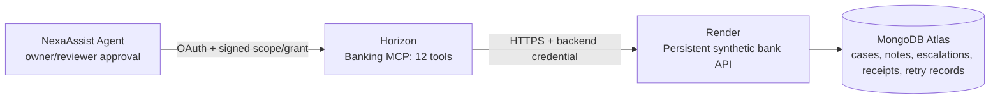

# Nexa Banking MCP

Independent Python project extracted from NexaAssist. Deploy **this repository**
to Horizon; the Agent, approval workflow, policy MCP, RAG and UI stay in NexaAssist.
No OpenAI keys, policy collections, owner/reviewer tokens or NexaAssist imports
are required here. Use a separate virtual environment.



## Code and ownership

| Path | Responsibility |
| --- | --- |
| `app/mcp/horizon.py:mcp` | Imported Horizon server, HTTP-client lifespan, mandatory signed context |
| `app/mcp/banking_server.py` | Twelve scoped tools, exact write grants, local stdio/HTTP entry point |
| `app/mcp/banking_http.py` | Signed customer scope, expiry and backend-identity verification |
| `app/banking_main.py:app` | Render FastAPI entry point; health, readiness, metrics and safe errors |
| `app/api/banking.py` | Authenticated `/v1` REST routes |
| `app/services/banking.py` | Fixture reads and write validation |
| `app/database/banking.py` | Atomic MongoDB mutations, counters and replay records |
| `app/models/` | Settings and banking contracts; no Agent dependencies |
| `app/services/banking_mcp.py` | Optional trusted HTTPX-to-MCP client adapter and encrypted OAuth cache |
| `app/data/` | Synthetic customer fixtures, transactions and original OpenAPI contract |
| `tests/fixtures/mock_bank.py` | Legacy in-memory reference, used only by tests |

Tools: `get_customer_profile`, `list_accounts`, `get_kyc_status`,
`get_bureau_summary`, `get_income`, `list_applications`, `list_transactions`,
`get_case`, `create_case`, `add_case_note`, `escalate_case`,
`create_service_request`.

Service requests support statement copy, callback, re-KYC reminder, interest
certificate and prepayment opt-in. A `RECEIVED` receipt records a request; it does
not actually send a statement, change a loan or execute a banking transaction.

## 1. Install and configure locally

From this repository, with Python 3.14 and uv installed:

```sh
uv sync --locked
cp .env.example .env
```

Edit `.env` privately. Use a dedicated Atlas database and a backend token with at
least 32 characters. Generate independent API/signing secrets in your terminal:

```sh
python3 -c 'import secrets; print(secrets.token_urlsafe(48))'
```

Run the command separately for each secret. Do not commit its output. For local
HTTP MCP, use another independent `BANKING_MCP_TOKEN` of at least 32 characters.

The Atlas database user needs `readWrite` on the dedicated banking database,
including collection/index creation. Atlas/replica-set transactions are required;
standalone MongoDB is rejected. Only cases, notes, escalations, service receipts,
counters and retry records are mutable; customer/account facts are bundled
synthetic fixtures. No vector index is used by this service.

Start the persistent API:

```sh
uv run --locked --no-sync --env-file .env ddtrace-run \
  uvicorn app.banking_main:app --host 127.0.0.1 --port 8080
```

`GET /health` checks the process; `/ready` checks Atlas; `/metrics` exposes a
storage-availability gauge. `/v1` requires the exact configured bearer credential.
There is no public reset endpoint and `X-Mock-Fault` is rejected.

## 2. MCP Inspector

Keep the API running in a separate terminal. Configure
`BANKING_MCP_CUSTOMER_IDS=["NXC-0010"]` in `.env` before starting Inspector.

Local **stdio** banking MCP, using a separate Inspector port from the policy MCP:

```sh
CLIENT_PORT=6284 MCP_SANDBOX_PORT=6285 MCP_APP_ORIGIN_PORT=6288 \
  npx -y @modelcontextprotocol/inspector@2.13.0 --web \
  uv run --locked --no-sync --env-file .env \
  env BANKING_MCP_TRANSPORT=stdio BANKING_MCP_WRITE_GRANT= \
  python -m app.mcp.banking_server
```

Open the Inspector URL printed by the command. Connect, list tools and call
`list_accounts` with `{"request":{"customer_id":"NXC-0010"}}`.
Inspector cannot write without an exact application-issued grant. Do not mint
grants from arbitrary tool input or bypass the owner/reviewer workflow.

For local **HTTP**, start the server first:

```sh
uv run --locked --no-sync --env-file .env \
  env BANKING_MCP_TRANSPORT=http python -m app.mcp.banking_server
```

Then launch Inspector:

```sh
CLIENT_PORT=6284 MCP_SANDBOX_PORT=6285 MCP_APP_ORIGIN_PORT=6288 \
  npx -y @modelcontextprotocol/inspector@2.13.0 --web
```

Choose Streamable HTTP, URL `http://127.0.0.1:9002/mcp`, and set
`Authorization: Bearer <your BANKING_MCP_TOKEN>` in the private connection
settings. Token-only reads use the configured customer allowlist; writes remain
denied. Only run one Inspector per port set; stop the old process with Ctrl-C or
choose another three free ports. The original repo's policy MCP command remains
there; this repository contains only banking.

## 3. Publish the independent repository

The standalone source is published at
[pankajshakya627/nexa-banking-mcp](https://github.com/pankajshakya627/nexa-banking-mcp)
on `main`. It contains no original Git history, `.env`, virtual environment or
credentials. Future updates can be published with:

```sh
git push origin main
```

Select this repository and its `main` branch in Horizon and Render. Grant their
GitHub apps access to the repository if it is not listed.

## 4. Deploy the banking API on Render first

1. Create a Docker Web Service from the **new repository**. Use root `Dockerfile`
   and health-check path `/ready`. `render.yaml` supplies the same settings.
2. The template selects an always-on **Starter** instance, which costs money.
   Review the current plan price before creating the service. No service has
   been activated by this extraction.
3. Set `BANKING_MONGODB_URI`, `BANKING_MONGODB_DB` and `BANKING_API_TOKEN` in
   Render's secret settings. Never add secrets as Docker build arguments.
4. Allow the service's documented outbound addresses in Atlas network access.
   Use a dedicated database user; no access to NexaAssist policy or run databases.
5. The container binds `0.0.0.0:${PORT:-8080}` as a non-root user. Keep one process
   initially. Configure Datadog delivery before enabling tracing; structured JSON
   logs are emitted to stdout. No local disk is used for durable bank records.
6. Verify the assigned HTTPS `/health` and `/ready`, then an authenticated
   `/v1/customers/NXC-0010/accounts`. A wrong/missing bearer token must return 401.

Render documentation: [Docker](https://render.com/docs/docker),
[health checks](https://render.com/docs/health-checks),
[network access](https://render.com/docs/outbound-ip-addresses).

## 5. Deploy banking MCP on Horizon

In [Horizon](https://horizon.prefect.io/), select the new repository and the
deployment branch. Set the exported server entry point to:

```text
app/mcp/horizon.py:mcp
```

Keep Gateway authentication **enabled**. Configure these private values:

| Horizon variable | Value |
| --- | --- |
| `BANKING_BASE_URL` | Render HTTPS base URL, including a trailing `/` |
| `BANKING_API_TOKEN` | Same backend token as Render |
| `BANKING_MCP_SIGNING_KEY` | Independent application signing secret, shared only with the trusted Agent |
| `AGENT_HTTP_TIMEOUT_SECONDS` | HTTP deadline, e.g. `60` |
| `DD_TRACE_ENABLED` | `false` until Datadog is configured |

Horizon needs no Atlas URI, static MCP bearer token, customer allowlist, write
grant environment variable, OpenAI credentials or owner/reviewer tokens. Customer
scope and exact grants arrive in signed request headers. It imports `mcp`; the
CLI `main()` is deliberately not part of the hosted startup path.

**Deployment gates:** confirm Horizon supports Python 3.14 and installs this
project, loads the exported object, enforces OAuth, and forwards both
`X-Nexa-Banking-Context` and `X-Nexa-Banking-Signature`. If any gate fails, stop the
rollout; do not downgrade Python or disable application authorization to deploy.
These provider-side checks have not been completed locally.

Horizon Inspector connections can authenticate using OAuth and discover tools.
Calling a tool also requires signed application context. Ordinary OAuth alone
does not authorize banking reads or writes; this is intentional. Test real calls
through the trusted Agent adapter after configuring it. Do not paste reusable
signing secrets into a generic Inspector connection.

## 6. Connect NexaAssist after deployment

The original Agent stays in the original repo and remains the approval authority.
Its existing local banking implementation is retained until the hosted route is
verified. `docs/nexaassist-horizon.patch` contains the optional client update;
review/apply it in NexaAssist, resolve lockfile updates with `uv lock`, and run its
unchanged checks before changing runtime settings. The patch does not move or
delete either local MCP server.

Configure the Agent privately:

```dotenv
BANKING_TRANSPORT=mcp
BANKING_MCP_TRANSPORT=http
BANKING_MCP_AUTH_MODE=oauth
BANKING_MCP_URL=https://<assigned-host>/mcp
BANKING_BASE_URL=https://<render-service>/
BANKING_API_TOKEN=<matching-backend-token>
BANKING_MCP_SIGNING_KEY=<matching-signing-key>
BANKING_MCP_OAUTH_STORAGE_KEY=<fernet-key>
```

Generate the **client-only** OAuth cache encryption key with:

```sh
uv run --locked --no-sync python -c 'from cryptography.fernet import Fernet; print(Fernet.generate_key().decode())'
```

From the patched Agent repo, authorize once as the OS user running NexaAssist:

```sh
uv run --locked --no-sync --env-file .env python -m app.mcp.horizon_login
```

Browser OAuth consent is required. Tokens are encrypted in
`~/.local/share/nexa-banking-mcp/oauth` (directory mode 0700), scoped to the MCP
URL; keep the Fernet key in your secret store. The runtime adapter refreshes
cached tokens but refuses to open an interactive login during an Agent request.
Missing/expired consent fails closed. See FastMCP's
[OAuth documentation](https://gofastmcp.com/docs/clients/auth/oauth).

OAuth owns `Authorization`; application scope/grants use separate signed headers.
`HORIZON_API_KEY` is not assumed to be an MCP access token. The shared signing key
belongs only to trusted application code. A client able to sign arbitrary scope
can authorize that scope, so do not distribute it to ordinary MCP users.

Finish or reconcile pending local approved runs before changing endpoints or
credentials. Backend identity includes URL and backend credential; retrying an
old approved operation against a new backend must be rejected. Run all five
service-request types through separate owner/reviewer approval and verify exact
receipt replay before switching the normal connection. A successful tool call is
not evidence that the approval workflow itself passed.

## Retry and storage guarantees

The unique claim is a SHA-256 key over caller, method, endpoint and idempotency
key. MongoDB transactions atomically commit the mutation, counters and full replay
result with majority write concern. Same-key/same-body requests replay the saved
201 body; a changed body returns 422. Records expire after 24 hours (TTL cleanup
can lag, so expiry is also checked during a request). After this window, a key can
create a new operation. Keep the shorter NexaAssist retry window unchanged.

A timeout or 503 can mean the reply was lost after commit. Reconcile using the
**same endpoint, body, credential and idempotency key**, never a new key. A retry
must not cross a backend migration. Customer fixtures are immutable, and no real
bank account changes are implemented.

## Verification

```sh
uv sync --locked
make check-task
make check-full
# Explicit live test, with BANKING_MONGODB_URI configured in .env:
make test-atlas
docker build -t nexa-banking-api:local .
```

The Atlas test creates a new `banking_smoke_<random>` database, verifies restart
persistence, concurrent duplicate claims, changed-body rejection, rollback and
commit-then-lost-reply recovery, then drops only that database. It never resets the
configured banking database. Local test doubles cannot prove transaction safety.
